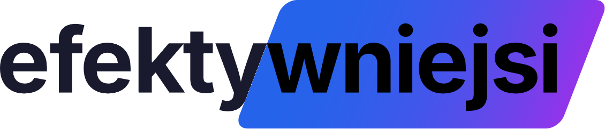
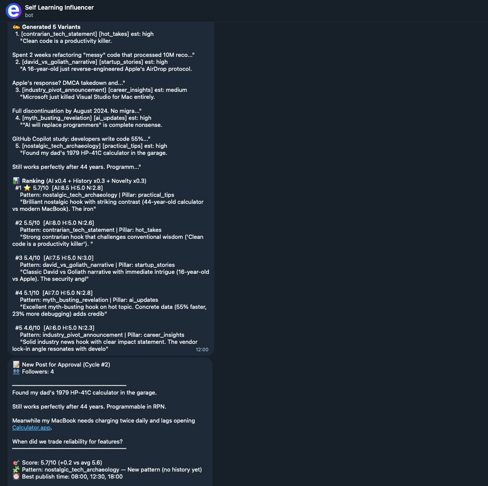
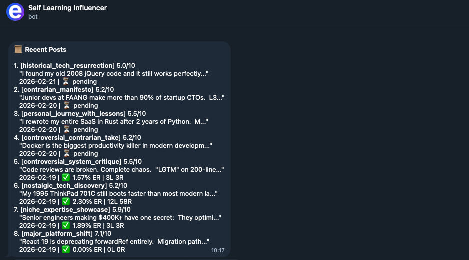
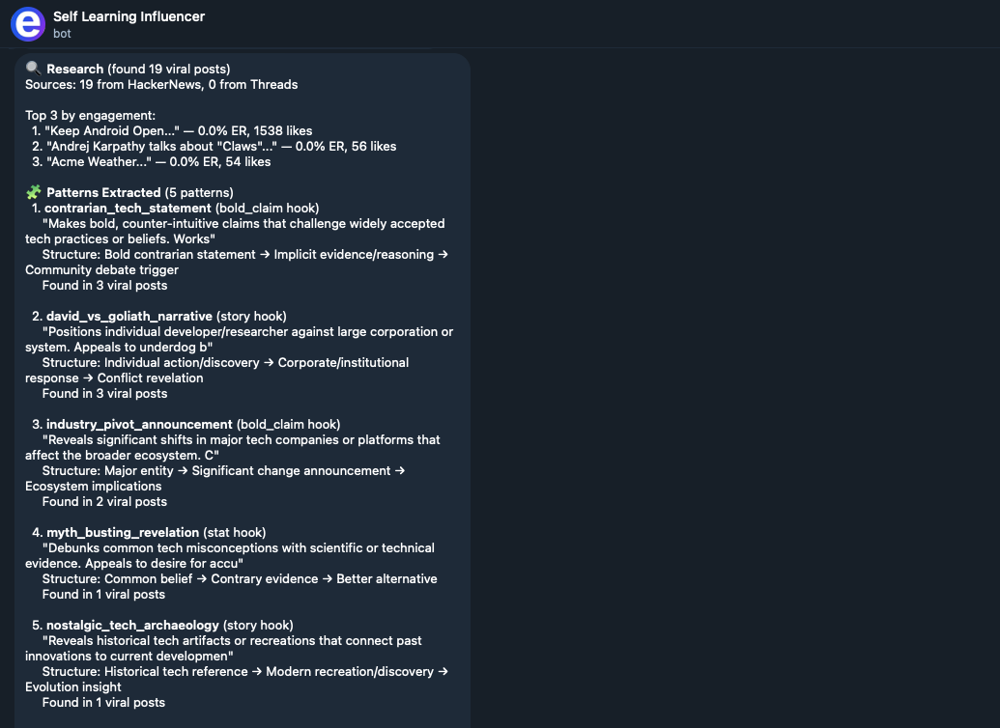
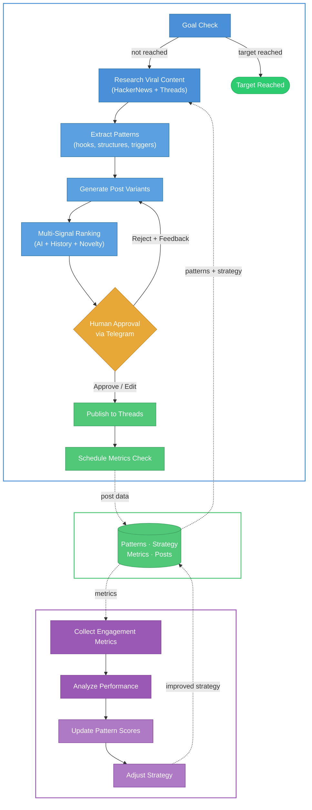
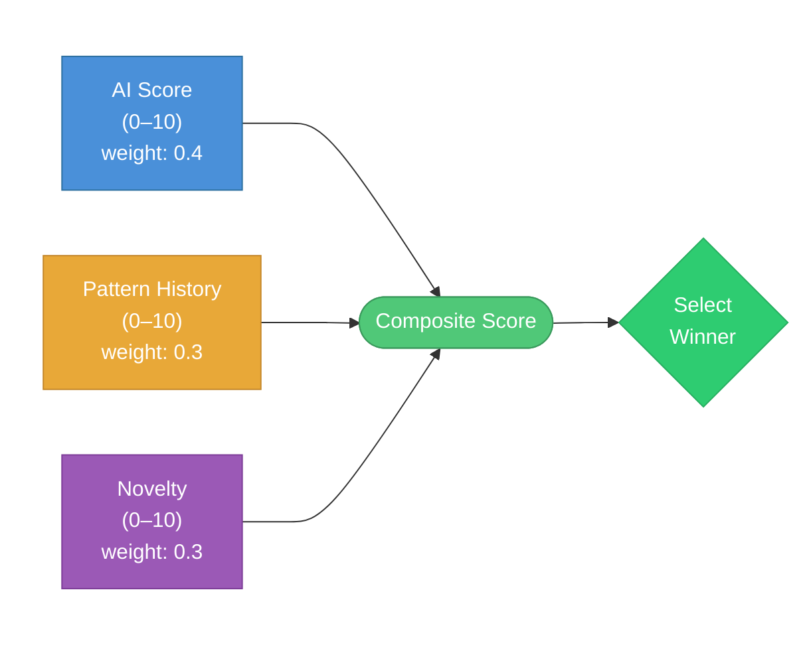
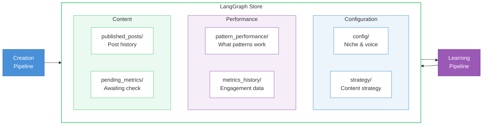

<!-- ============================================ -->
<!--            HERO SECTION                      -->
<!-- ============================================ -->

<div align="center">

<a href="https://efektywniejsi.pl/">
  <picture>
    <source media="(prefers-color-scheme: dark)" srcset="docs/screenshots/efektywniejsi-logo.png">
    <source media="(prefers-color-scheme: light)" srcset="docs/screenshots/efektywniejsi-logo-dark.png">
    
  </picture>
</a>

<br/><br/>


<br/>

# AutoViralAI

### Your social media grows while you sleep.

<p>
An autonomous AI agent that researches what's going viral, generates content,<br/>
publishes it, measures engagement — and <strong>rewrites its own strategy based on what actually worked</strong>.
</p>

<br/>

[](https://github.com/kgarbacinski/AutoViralAI/actions/workflows/ci.yml)
[](https://www.python.org/downloads/)
[](LICENSE)
[](https://github.com/langchain-ai/langgraph)
[](https://github.com/astral-sh/ruff)
[](https://www.docker.com/)
[](https://developers.facebook.com/docs/threads/)

<br/>

[Real Results](#-real-results) · [Demo](#-demo) · [Quick Start](#-quick-start) · [Self-Hosting](docs/SELF_HOSTING.md) · [How It Works](#-how-it-works) · [Configuration](#-configuring-your-niche) · [Roadmap](#-roadmap) · [Contributing](CONTRIBUTING.md)

<br/>

<a href="https://github.com/kgarbacinski"></a>

<sub>built by <a href="https://github.com/kgarbacinski">@kgarbacinski</a>. follow for the next agent.</sub>

</div>

<br/>

---

<!-- ============================================ -->
<!--         REAL RESULTS                         -->
<!-- ============================================ -->

## 🔥 Real Results

We've been running AutoViralAI for **~1.5 months** on a tech/programming Threads account. Here are some posts that went viral — **every single one was researched, generated, and ranked by the agent:**

<div align="center">


<br/><br/>


<br/><br/>


</div>

<br/>

> **800+ likes on a single post.** The agent learned that contrarian "old tech vs new tech" hooks and relatable developer war stories consistently outperform generic tips — and it adapted its strategy automatically.

<br/>

---

<!-- ============================================ -->
<!--            DEMO SECTION                      -->
<!-- ============================================ -->

## 🎬 Demo

<div align="center">

<em>See it in action — the agent researches trends, generates posts, ranks them, and sends you an approval request.</em>

<br/><br/>



<br/>



<br/>



</div>

<br/>

---

<!-- ============================================ -->
<!--         PROBLEM / SOLUTION                   -->
<!-- ============================================ -->

## 💡 The Problem

You know you should be posting consistently. You know what kind of content performs. But researching trends, writing posts, tracking what works, adjusting strategy — **it's a full-time job**.

## 💡 The Solution

AutoViralAI does the entire loop autonomously. It doesn't just post — it ***learns***. Every day it gets a little better at understanding what your audience actually engages with.

<div align="center">

</div>

```
Day 1:   "Here's a generic coding tip"            → 12 likes
Day 7:   "Hot take: most devs don't need Docker"   → 340 likes
Day 14:  Agent learned contrarian hooks work 3x     → adapts strategy automatically
Day 30:  Posts consistently hit 500+ engagement     → you didn't write a single one
Day 45:  Single post hits 800 likes                 → the agent wrote it, not you
```

<br/>

---

<!-- ============================================ -->
<!--         WHY AUTOVIRALAI                      -->
<!-- ============================================ -->

## ⚡ Why AutoViralAI?

Most "AI social media tools" are glorified schedulers with a GPT wrapper. They generate generic content, blast it out, and call it a day.

**AutoViralAI is fundamentally different:**

| | Traditional tools | AutoViralAI |
|:---:|---|---|
| 🔍 | Generate content from a static prompt | Research what's *actually* going viral right now, extract the patterns, and generate content using those patterns |
| 📈 | Same strategy forever | Strategy evolves daily based on real engagement data |
| 📊 | Post and forget | Measure results after 24h, learn what worked and why, feed it back |
| 🏆 | AI picks the post | Multi-signal ranking: AI score + historical pattern performance + novelty scoring |
| 🛡️ | Fully automated (risky) | Human-in-the-loop: you approve every post via Telegram before it goes live |

<br/>

---

<!-- ============================================ -->
<!--            KEY FEATURES                      -->
<!-- ============================================ -->

## ✨ Key Features

<table>
<tr>
<td width="50%" valign="top">

### 🧠 Self-Learning Loop
The agent doesn't just execute. It observes, measures, and adapts. Pattern that got 3x engagement? It'll use it more. Strategy that flopped? Automatically deprioritized.

</td>
<td width="50%" valign="top">

### 🏆 Multi-Signal Ranking
Posts aren't ranked on "AI vibes." Each variant scores on 3 independent signals: AI-evaluated viral potential, historical pattern performance, and novelty (so it doesn't repeat itself).

</td>
</tr>
<tr>
<td width="50%" valign="top">

### 🛡️ Human-in-the-Loop
Nothing gets published without your approval. The agent sends you the top-ranked post via Telegram. You approve, edit, or reject. Built on LangGraph's `interrupt()` — survives server restarts.

</td>
<td width="50%" valign="top">

### 🎯 Niche-Aware
Define your voice, audience, content pillars, and topics to avoid in a single YAML file. The agent stays on-brand in every cycle.

</td>
</tr>
<tr>
<td width="50%" valign="top">

### 🔍 Research-Driven
Before generating anything, the agent scrapes Threads and HackerNews to understand what's trending *right now* in your niche. No hallucinated trends.

</td>
<td width="50%" valign="top">

### 🚀 Production-Ready
PostgreSQL persistence, Docker deployment, CI/CD via GitHub Actions, Telegram webhooks, APScheduler for cron-like execution. Not a toy — this runs 24/7.

</td>
</tr>
</table>

<br/>

---

<!-- ============================================ -->
<!--            QUICK START                       -->
<!-- ============================================ -->

## 🚀 Quick Start

### Prerequisites

- Python 3.13+
- [uv](https://docs.astral.sh/uv/) (recommended) or pip
- An [Anthropic API key](https://console.anthropic.com/)

### Setup

```bash
git clone https://github.com/kgarbacinski/AutoViralAI.git
cd AutoViralAI
uv sync
cp .env.example .env
# Edit .env → set ANTHROPIC_API_KEY (minimum required)
```

### Run Your First Cycle

```bash
# Interactive mode — you approve/reject posts in the terminal
uv run python scripts/manual_run.py

# Auto-approve mode (for testing the full pipeline)
uv run python scripts/manual_run.py --auto-approve

# Run the learning pipeline
uv run python scripts/manual_run.py --pipeline learning
```

> **Note:** The first run uses **mock APIs** — no social media account needed. You'll see the full pipeline execute with realistic simulated data.
>
> To post to a real account, follow the **[Self-Hosting guide](docs/SELF_HOSTING.md)**.

<br/>

---

<!-- ============================================ -->
<!--            HOW IT WORKS                      -->
<!-- ============================================ -->

## 🔄 How It Works

The system runs **two independent pipelines** that share a knowledge base:



**Why two pipelines?** Posts need 24-48 hours to accumulate meaningful engagement data. The creation pipeline runs multiple times per day, while the learning pipeline runs once daily on yesterday's data — then feeds the improved strategy back into creation.

### 🔁 The Self-Learning Loop

```mermaid
graph LR
    R["Research<br/>What's viral?"] --> E["Extract<br/>Why it works"]
    E --> G["Generate<br/>Using patterns"]
    G --> K["Rank<br/>AI + History + Novelty"]
    K --> P["Publish<br/>Post the winner"]
    P --> M["Measure<br/>Wait 24h, collect data"]
    M --> L["Learn<br/>What worked & why"]
    L --> A["Adapt<br/>Update strategy"]
    A -->|"feed back"| R

    style R fill:#4A90D9,stroke:#2C6FA0,color:#fff
    style E fill:#5BA0E0,stroke:#2C6FA0,color:#fff
    style G fill:#5BA0E0,stroke:#2C6FA0,color:#fff
    style K fill:#E8A838,stroke:#C4872A,color:#fff
    style P fill:#50C878,stroke:#3A9A5C,color:#fff
    style M fill:#9B59B6,stroke:#7D3C98,color:#fff
    style L fill:#AF7AC5,stroke:#7D3C98,color:#fff
    style A fill:#AF7AC5,stroke:#7D3C98,color:#fff
```



### 📊 Multi-Signal Ranking

Each variant gets a **composite score** from three independent signals:



| Signal | What it measures | How |
|--------|-----------------|-----|
| **AI Score** (0-10) | Viral potential: hook strength, emotional trigger, shareability | Claude evaluates each variant |
| **Pattern History** (0-10) | How well this pattern performed in the past | Cumulative engagement data from knowledge base |
| **Novelty** (0-10) | How different this is from recent posts | Cosine distance of embeddings vs last 20 posts |

New patterns get a **5.0 exploration bonus** — the system balances exploitation (use what works) with exploration (try new things).

### 🤝 Human-in-the-Loop

The agent never posts without your approval. Before the approval message, you get a **full pipeline report** showing what each agent did — research results, extracted patterns, generated variants, and ranking breakdown.

<div align="center">


<br/>


<br/>


</div>

<br/>

Built on LangGraph's `interrupt()` — the graph pauses, saves state, and resumes when you respond. Survives server restarts.

<br/>

---

<!-- ============================================ -->
<!--        CONFIGURING YOUR NICHE                -->
<!-- ============================================ -->

## 🎯 Configuring Your Niche

Edit `config/account_niche.yaml` to define your identity:

```yaml
niche: "tech"
sub_niche: "programming & startups"

voice:
  tone: "conversational, insightful, slightly provocative"
  persona: "experienced developer who shares hard-won lessons"
  style_notes:
    - "Use short, punchy sentences"
    - "Lead with a controversial or surprising take"
    - "End with a question or call-to-action"

content_pillars:
  - name: "hot_takes"
    description: "Contrarian opinions on tech trends"
    weight: 0.30
  - name: "practical_tips"
    description: "Actionable coding tips and tool recommendations"
    weight: 0.25
  # ... add your own pillars

avoid_topics:
  - "political opinions unrelated to tech"
  - "cryptocurrency shilling"
```

The agent uses this config in every generation cycle to stay on-brand and on-topic.

<br/>

---

<!-- ============================================ -->
<!--            ARCHITECTURE                      -->
<!-- ============================================ -->

## 🏗️ Architecture

```
AutoViralAI/
├── config/
│   ├── account_niche.yaml       # Your niche, voice, audience, content pillars
│   └── settings.py              # Environment config (pydantic-settings)
│
├── src/
│   ├── models/                  # Pydantic models + TypedDict states
│   ├── graphs/                  # LangGraph pipeline definitions
│   │   ├── creation_pipeline.py # Research → generate → approve → publish
│   │   └── learning_pipeline.py # Metrics → analyze → learn → adapt
│   ├── nodes/                   # Individual pipeline steps (11 nodes)
│   ├── tools/                   # External service wrappers (mock-first)
│   ├── prompts/                 # All LLM prompt templates
│   ├── store/                   # Knowledge base (LangGraph Store)
│   ├── orchestrator.py          # APScheduler (cron-like scheduling)
│   └── persistence.py           # Checkpointer + Store factory
│
├── bot/                         # Telegram bot (approval, commands, config)
├── api/                         # FastAPI server
├── scripts/                     # Manual run, init, health check
└── tests/                       # pytest suite
```

### 📦 Knowledge Base

Both pipelines share a persistent knowledge base via [LangGraph Store](https://langchain-ai.github.io/langgraph/concepts/persistence/#store):



Dev: `InMemoryStore` · Prod: `AsyncPostgresStore` with embedding support.

<br/>

---

<!-- ============================================ -->
<!--            TECH STACK                        -->
<!-- ============================================ -->

## 🛠️ Tech Stack

| Component | Technology | Purpose |
|-----------|-----------|---------|
| Agent Framework | [LangGraph](https://github.com/langchain-ai/langgraph) 0.3+ | Two-graph architecture with shared state |
| LLM | Claude Sonnet 4.6 via [langchain-anthropic](https://github.com/langchain-ai/langchain) | Pattern extraction, generation, ranking, analysis |
| State Persistence | LangGraph Checkpointer | Survives interrupts, restarts, crashes |
| Knowledge Base | LangGraph Store | Cross-pipeline memory with namespaces |
| Human-in-the-Loop | LangGraph `interrupt()` + [python-telegram-bot](https://github.com/python-telegram-bot/python-telegram-bot) | Pause graph, notify via Telegram, resume on response |
| Research | [Apify](https://apify.com/) + HN Firebase API | Threads + HackerNews viral content discovery |
| Novelty Scoring | Cosine similarity on embeddings | Prevent repetitive content |
| Scheduling | [APScheduler](https://apscheduler.readthedocs.io/) | Creation 3x/day, learning 1x/day |
| API | [FastAPI](https://fastapi.tiangolo.com/) | Webhook receiver + status endpoints |
| Database | PostgreSQL (prod) / In-memory (dev) | Checkpoints, store, metrics |
| Validation | [Pydantic](https://docs.pydantic.dev/) v2 | Structured LLM output + data models |

<br/>

---

<!-- ============================================ -->
<!--            TESTS                             -->
<!-- ============================================ -->

## 🧪 Tests

```bash
# Run all tests
uv run pytest

# With coverage
uv run pytest --cov=src --cov=bot --cov=api --cov-report=term-missing

# Lint
uv run ruff check .
```

<br/>

---

<!-- ============================================ -->
<!--         PRODUCTION DEPLOYMENT                -->
<!-- ============================================ -->

## 🐳 Production Deployment

Ready to run it on your own Threads account? **[docs/SELF_HOSTING.md](docs/SELF_HOSTING.md)** walks through every key (Anthropic, Telegram, Threads, Apify), the server + HTTPS setup, optional GitHub Actions auto-deploy, and a checklist to confirm it works.

<br/>

---

<!-- ============================================ -->
<!--            ROADMAP                           -->
<!-- ============================================ -->

## 🗺️ Roadmap

- ✅ Two-graph architecture (creation + learning)
- ✅ Mock-first development (works without API keys except Anthropic)
- ✅ Multi-signal ranking (AI + history + novelty)
- ✅ Human-in-the-loop via `interrupt()`
- ✅ Configurable niche/voice/audience
- ✅ CI/CD: GitHub Actions → auto-deploy on push to main
- ✅ Telegram bot approval flow (end-to-end)
- ✅ Pipeline transparency — full AI agent report (research, patterns, generation, ranking)
- ✅ Enriched approval messages — metrics benchmark, pattern rationale, optimal publish time
- ✅ Reject with feedback — reason buttons feed back into the learning loop
- ✅ Publish later — schedule approved posts for optimal times
- ✅ Bot commands — `/metrics`, `/history`, `/schedule`, `/force`, `/learn`, `/research`, `/pause`, `/resume`
- ✅ Remote config via Telegram — `/config` to change tone, language, hashtags, posting schedule
- ✅ Live `/status` — running/paused state, cycles, pending approvals, next run
- ✅ Standalone `/research` — see what virals the agent finds without running the full pipeline
- ✅ Real Threads API integration
- 🔲 LangSmith observability dashboard
- 🔲 A/B testing (publish two variants, compare)
- 🔲 Multi-platform support (X, Bluesky, LinkedIn)
- 🔲 Web dashboard for strategy visualization
- 🔲 Configurable LLM provider (OpenAI, Ollama)
- 🔲 Plugin system for research sources

<br/>

---

<!-- ============================================ -->
<!--            CONTRIBUTING                      -->
<!-- ============================================ -->

## 🤝 Contributing

Contributions are welcome! Please read the [Contributing Guide](CONTRIBUTING.md) for details on the development workflow, code style, and how to submit pull requests.

Some good first issues:

- Add more content pattern templates
- Implement real Reddit research with better filtering
- Add retry logic with exponential backoff for API calls
- Build a web dashboard showing learning progress
- Add support for image/carousel posts
- Add support for new platforms (X, LinkedIn, Bluesky)

<br/>

---

<!-- ============================================ -->
<!--            LICENSE + STAR                    -->
<!-- ============================================ -->

## 📄 License

[MIT](LICENSE)

<br/>

---

<div align="center">

### ⭐ Star History

If you find this project useful, consider giving it a star!

[](https://star-history.com/#kgarbacinski/AutoViralAI&Date)

<br/>

### 🧠 One last thing the agent taught us

Its own config says <code>End with a question or call-to-action to drive engagement</code>.<br/>
Ignoring the agent in its own README would be rude, so:

**[→ follow @kgarbacinski](https://github.com/kgarbacinski)** for the next agent.<br/>
And the question: what should an agent automate for you next? **[Tell me in an issue](https://github.com/kgarbacinski/AutoViralAI/issues/new?title=Next%20agent%20idea%3A%20)**.

<br/>

<sub>Created by <a href="https://github.com/kgarbacinski">@kgarbacinski</a>, co-founder at <a href="https://efektywniejsi.pl/">Efektywniejsi</a>. We build custom AI solutions for businesses and people.</sub>

</div>
